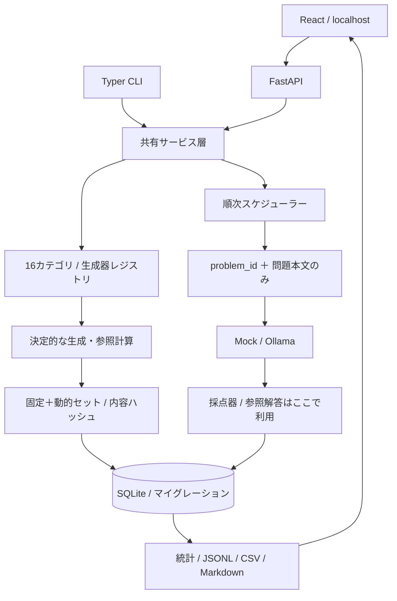

# アーキテクチャ

`domain.py` が型と正規化JSON/ハッシュを定義します。生成器はpureなPython関数で、モデルやネットワークに依存しません。`register` に追加した生成器がAPIと三層UIへ自動反映されます。現状は組み込みモジュール内の明示的な登録のみで、外部の任意プラグインコードをロードしません。

`sets.py` は選択生成器を必ず1回含め、残りをカテゴリ均等に配分します。バージョン管理された小規模固定コーパスをサンプリングし、動的生成と混合。表面的重複を拒否して、確定した問題実体・参照解答・順序・重み・設定・版をSQLiteへ保存します。

`runner.py` は問題ごとに `Problem.public()` を作り、`PublicProblem` のみをアダプターへ渡します。Mockも参照解答を受け取りません。採点は回答が戻った後に行います。SQLiteの結果キー `(run_id, index)` は一意です。スケジューラーはファイルロックで1プロセスに限定し、APIのキュー操作と状態遷移は同じasyncioイベントループに集めます。

APIはSSEで最新版の永続化スナップショットを配信。再接続では古いイベントを全再生せず、最新状態を必ず送ります。プロセス終了時や再起動時に処理途中のランをpausedへ移行し、保存済み問題をスキップして再開します。一時停止は問題境界で反映し、中止は実行中awaitをキャンセルします。Transformersはプロセスグループ、コード採点はコンテナを終了・回収します。

SQLiteは短いトランザクション、WAL、foreign_keys、busy timeoutを使用。現状のスキーマはuser_version=2。将来の移行は既存データを保持する前方向マイグレーションを追加します。未知の新しい版は拒否します。APIのDB操作はパラメーター化し、ファイルパスをAPI入力から選べる構成にはしていません。

UIは表示・フォーム・接続管理のみで、生成・採点・集計を実装しません。ルートはhash形式で、リロード後も結果画面に戻れます。開発ではViteのプロキシ、ビルド後はFastAPIで静的配信。同一Originで完結する既定構成です。

Transformersは問題ごとの別プロセスで、ローカルsafetensorsモデルをCPU/CUDAにロードします。依存・モデルディレクトリ・設定の事前条件を満たせば利用可能ですが、実推論はNOT_VERIFIEDです。タイムアウト/中止時はプロセスグループをkillし回収します。この境界はsandboxではありません。Dockerコードワーカーは実行プロセスごとに実検証して有効化します。Codexの実通信transport、ChatGPTサインインは未実装/未検証です。Codexの経路は `available=false` とし、通常のrun作成時に拒否します。存在するDockerやCodexバイナリだけで安全性・認証・推論を成立したことにしません。

DB v2のattemptsはすべての試行の履歴、resultsは現行の採点用結果です。コード/ツール/速度/holdoutも同じFrozenSetとSchedulerを使い、evaluation_modeとprofile_versionで区別します。code_evalのテスト入力だけをDockerへ送り、参照出力はホストに残します。tool_evalは許可リスト付き純粋状態機械で外部操作をしません。詳細はADR 0003を参照してください。
